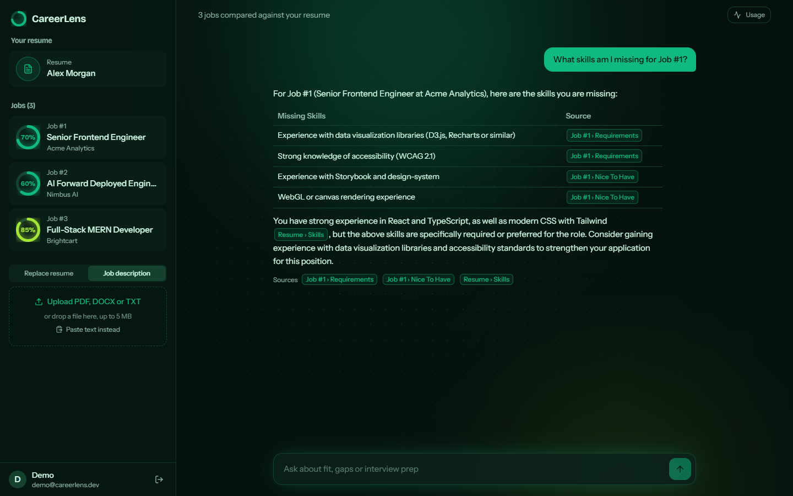
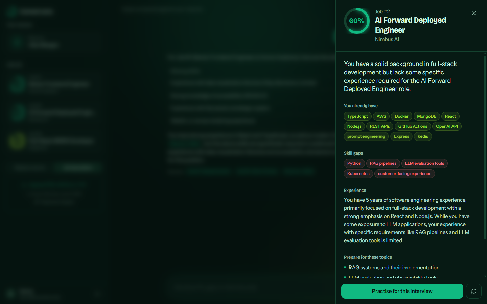
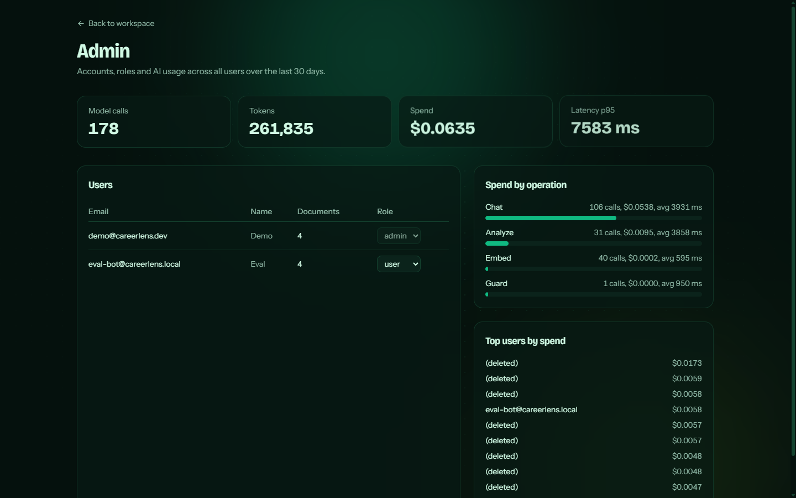
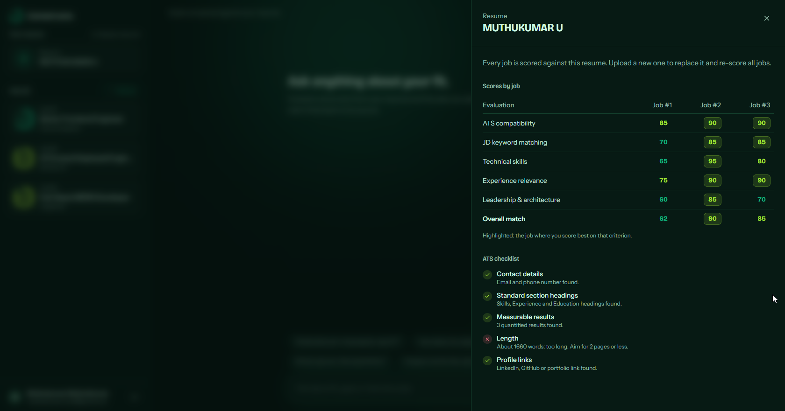
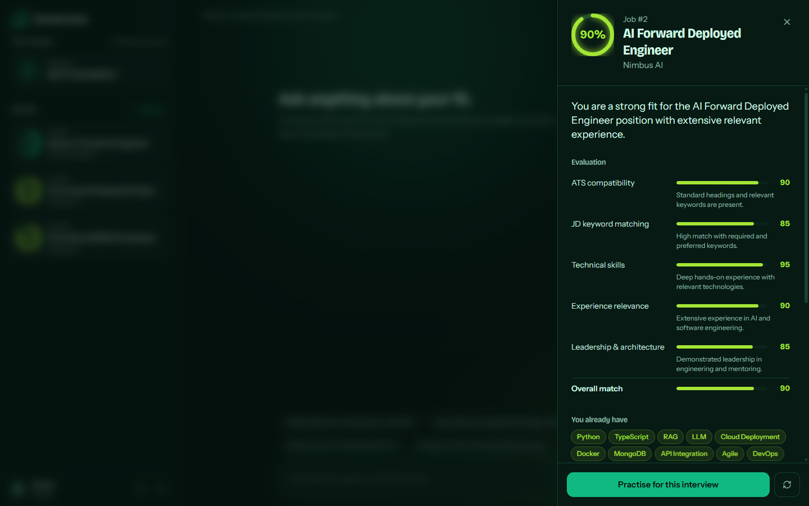
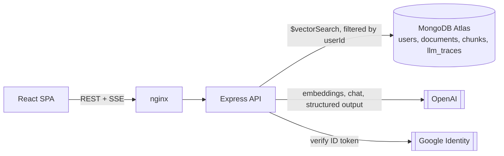

# CareerLens: Career Intelligence Assistant

Upload your resume and the job descriptions you are considering. CareerLens scores your fit for each job,
names the skills you're missing, and answers questions such as *"What am I missing for Job #2?"* or
*"Prepare me for the Nimbus interview"*. Every claim in an answer cites the document and section it came from.

Built for the Newpage Solutions AI FDE assignment (Option 4: Career Intelligence Assistant).

**Live demo:** https://p01--frontend--g6dls6wx7pbl.code.run (Northflank; the free tier may take a few seconds to wake up).
Create an account, then click **Try with sample data**.



| Sign in (email or Google) | Fit drawer | Admin and usage |
|---|---|---|
|  |  |  |

| Resume evaluation across jobs | Job scorecard |
|---|---|
|  |  |

**Stack:** MongoDB Atlas (documents and vector search), Express + TypeScript, React 19 + Vite + Tailwind v4, OpenAI.
**Tests:** 97 backend + 27 frontend. **Eval:** 12-question golden set run against the real model.

---

## 1. Quick start

### Prerequisites
Node 20+, an OpenAI API key, and a MongoDB Atlas cluster (the free M0 tier works). Docker is optional.

### Run locally
```bash
# backend
cd backend
cp .env.example .env        # fill in MONGODB_URI, OPENAI_API_KEY, JWT_SECRET
npm install
npm run dev                 # http://localhost:4000 — creates DB "career_intelligence" + vector index on first start

# frontend (second terminal)
cd frontend
cp .env.example .env        # optional: VITE_GOOGLE_CLIENT_ID
npm install
npm run dev                 # http://localhost:5190
```
Open http://localhost:5190, create an account, and click **Try with sample data** (one resume and three job descriptions).

### Run with Docker
```bash
docker compose up --build   # http://localhost:8080 (nginx serves the SPA and proxies /api)
```
No Atlas account? Set `MONGODB_URI=mongodb://mongo:27017/?directConnection=true` in `backend/.env` and
run `docker compose --profile local-db up --build`. This uses MongoDB's `atlas-local` image, which includes Vector Search.

### Deploy (Cloudflare Pages + R2, API on Northflank)
Step-by-step guide: [docs/deploy-cloudflare.md](docs/deploy-cloudflare.md). Cloudflare Pages serves the SPA, and a Pages
Function proxies `/api/*` to the API container on Northflank (Render also documented), so the browser sees one origin. Original uploads are kept
in a private Cloudflare R2 bucket.

### Google sign-in (optional)
In Google Cloud Console, open *APIs & Services → Credentials → OAuth client ID (Web)*. Add `http://localhost:5190` and
`http://localhost:8080` as authorised JavaScript origins. Put the client ID in `backend/.env` (`GOOGLE_CLIENT_ID`) and
`frontend/.env` (`VITE_GOOGLE_CLIENT_ID`). Without it, the Google button is hidden and email/password still works.

### Admin access
Sign in with Google using the address in `ADMIN_EMAIL`, or run `npm run make-admin -- you@example.com` in `backend/`.

### Tests and evaluation
```bash
cd backend && npm test      # unit + API tests (in-memory MongoDB, OpenAI faked)
cd frontend && npm test     # component tests
cd backend && npm run eval  # golden-set evaluation against the real model + Atlas (costs about $0.01)
```

---

## 2. Architecture



- **Ingest:** extract text (pdf-parse / mammoth) → split by section → embed → store chunks with `userId`, `docId`, label and section.
  The original file goes to Cloudflare R2 (`users/{userId}/{docId}.pdf`, private, downloadable only by its owner) when `R2_*` is configured.
  Adding a job, or replacing the resume, triggers a background **fit analysis** (one structured-output call per job)
  that returns a fit score plus a 5-criterion **scorecard** (ATS compatibility, JD keyword matching, technical skills,
  experience relevance, leadership & architecture). The resume panel compares all jobs side by side and adds a
  **rule-based ATS checklist** (contact details, section headings, measurable results, length, profile links).
  It's rule-based on purpose: those checks are mechanical, so code is instant, free, deterministic and explainable.
- **Chat:** guard → route ("Job #2", title or company) → retrieve → prompt → stream over SSE → citation filter → trace.
- **Auth:** email/password (bcrypt) or Google ID token → our own JWT in an httpOnly cookie; roles `user` / `admin`.

Full diagrams (components, chat sequence, data model) are in [docs/architecture.md](docs/architecture.md).

```
backend/src
  auth/       JWT cookie, Google verification, requireAuth / requireRole
  ingest/     extraction + section-aware chunker
  rag/        router (job refs), retriever (Atlas), context, guard, prompt, citations
  analysis/   per-job fit analysis (JSON schema output)
  llm/        OpenAI wrapper + token/cost tracing
  routes/     documents, chat (SSE), admin/metrics, health
frontend/src
  pages/      Login, Workspace, Admin
  components/ FitRing, ChatPanel, Message, FitDrawer, Sidebar, UploadZone, ...
```

---

## 3. RAG / LLM approach and decisions

<!-- Facts and measurements below are accurate. Muthu: review the "why" wording and make it yours. -->

| Concern | Options considered | Choice | Why |
|---|---|---|---|
| LLM | gpt-4o-mini, gpt-4.1-mini, Claude | **gpt-4o-mini** (configurable via `OPENAI_CHAT_MODEL`) | Cheap and fast enough for streaming. In the eval, gpt-4.1-mini did not fix citation misses; prompt changes did. |
| Embeddings | text-embedding-3-small / -large | **text-embedding-3-small** (1536-d) | Resumes and job descriptions are short and plain. The large model's extra accuracy isn't worth 6.5× the cost here. |
| Vector DB | Chroma, Pinecone, pgvector, **Atlas Vector Search** | **Atlas Vector Search** | Already on MongoDB (MERN), so one store for users, documents, vectors and traces. Pre-filters by `userId` and `docId`. The same code runs on `atlas-local` in Docker. |
| Orchestration | LangChain, LlamaIndex, hand-written | **Hand-written (~300 lines)** | Every step is visible and testable. A framework would hide exactly the decisions this assignment evaluates. |

**Chunking.** Resumes and job descriptions are short and highly structured, so text is split on their own headings
(Skills, Experience, Requirements, Nice to have…; [chunker.ts](backend/src/ingest/chunker.ts)). Long sections
are windowed at about 800 tokens with about 100 tokens of overlap. Each chunk keeps its document label and section, which
both drives the citations (`[Job #2 › Requirements]`) and lets retrieval filter by document. The embedded text is
prefixed with "Job – title – section" so each vector carries that context.

**Retrieval.** ([context.ts](backend/src/rag/context.ts))
1. **Small corpus → no search.** One resume plus a few job descriptions is usually under ~6k tokens, so everything is sent.
   Retrieval can only *lose* information; it earns its keep when the corpus outgrows the context budget.
2. **Targeted questions.** [router.ts](backend/src/rag/router.ts) resolves "Job #2", "#2", or a distinctive
   title or company word ("Nimbus") to job IDs, then searches *only* those jobs plus the resume (k=4 each). Without this,
   similar requirement sections from different jobs get mixed together.
3. **Untargeted questions.** Global top-8, then at least 2 resume chunks are guaranteed, because every question here is "me vs. the job".
4. References to jobs that don't exist ("Job #7") are reported to the model, which tells the user.

**Prompt and context management.** ([prompt.ts](backend/src/rag/prompt.ts))
- System prompt: role, grounding rules, citation format with a worked example, "check every resume section before calling something a gap", and documents declared as untrusted data.
- Document text goes into escaped `<document label section>` blocks, and titles are flattened and escaped.
- Retrieved context is attached only to the current turn. History is the last 6 turns, capped at 4k characters per turn and 12k in total.
- A citation reminder is the **last line** of the user message, because recency measurably helped.

**Guardrails.**
| Layer | What |
|---|---|
| Input | length limits, per-user rate limit (20 chats/min), off-topic classifier (keyword fast path, otherwise a 1-word LLM call; *fails open*) |
| Prompt injection | documents are tagged and escaped, untrusted-data instruction, and model output is rendered without images or non-http links |
| Output | citations pointing at documents that were not in the context are removed ([citations.ts](backend/src/rag/citations.ts)) |
| Structured | the fit analysis uses JSON-schema structured output and is validated again with zod |
| Tenancy | every query and every `$vectorSearch` is filtered by `userId`; other users' IDs return 404 |

**Quality: the eval loop.** `npm run eval` runs 12 golden questions over the sample data against the real model
and Atlas, and measures **grounded answers** (≥1 valid citation; the gate is ≥90%), **label recall** and **keyword recall**.
What it caught:

| Change | Grounded | Label recall | Keyword recall |
|---|---|---|---|
| First prompt | — | 40%* | 97% |
| + worked example, end-of-message reminder, evidence rule | 100% | 100%* | 100% |
| + table questions added to the golden set (exposed a regression), + "tables need a Source column" | 100% | 88–96% | 89% |

\* the first metric counted a question as passed only if *all* expected documents were cited. It was replaced because
"what am I missing" answers legitimately cite only the job (you can't cite an absence). Results vary about ±8 points
between runs, so compare a few runs before trusting a change.

**Observability.** Structured pino logs with a request ID on every request (`x-request-id`). Every LLM call is
written to `llm_traces` (operation, model, tokens, latency, cost). `/api/metrics` shows a user their own usage, and the
admin dashboard shows totals, p50/p95 latency, spend per operation and per user. Each chat logs its retrieval
decisions (full-text vs. search, targeted jobs, missing refs, number of sources).

---

## 4. Productionising on a hyperscaler

<!-- Muthu: this is a starting list. Keep the items you'd defend in an interview and add your own experience. -->

| Area | Now | Production |
|---|---|---|
| Compute | 2 containers | AWS ECS Fargate / GCP Cloud Run / Azure Container Apps; frontend as static files on S3 + CloudFront (or Cloudflare Pages) |
| Database | Atlas M0 | Atlas M10+ in the same region and cloud, private endpoint / VPC peering, backups, dedicated Search Nodes when vector load grows |
| Ingestion | in-request + fire-and-forget analysis | queue (SQS / Pub/Sub / Service Bus) + worker; retries; status per document; virus scan on uploads; original files in object storage |
| Secrets | `.env` | Secrets Manager / Secret Manager / Key Vault; key rotation; least-privilege DB user |
| Auth | JWT cookie, Google | refresh tokens with rotation, email verification and password reset, MFA, or a managed IdP (Cognito / Auth0 / Entra ID) |
| Abuse and cost | in-memory rate limit | Redis-backed limits per user and IP, monthly token budgets per user, WAF |
| Observability | pino + `llm_traces` | OpenTelemetry traces → CloudWatch / Cloud Logging / Datadog; LLM tracing in Langfuse or LangSmith; alerts on error rate, p95 and spend |
| Quality | local golden set | eval in CI on prompt or model changes, a larger golden set, LLM-as-judge for faithfulness, user feedback buttons feeding the set |
| Delivery | manual | GitHub Actions: lint, test, build, image scan, deploy to staging, smoke test + eval, promote |
| Privacy | — | resumes are PII: encryption at rest, retention policy, deletion on request, a data-processing agreement with the LLM provider |

---

## 5. Key technical decisions

<!-- DRAFT: Muthu, rewrite this section in your own words (Newpage asked for your thinking, not an LLM's).
Facts you can draw on:
- MERN chosen because it's my stack; Atlas Vector Search keeps one database (no second vector store to sync).
- Hand-written RAG instead of LangChain: explainable, testable, small.
- "Full text when it fits" before vector search: documents are tiny; retrieval only adds failure modes at this size.
- Job-reference routing ("Job #2") because similar requirement sections from different jobs get confused.
- Dependency injection (createApp(deps)) so every external service is faked in tests; only Mongo is real (in-memory).
- JWT in an httpOnly cookie (not localStorage) and roles re-read from the DB on every request.
- Security review caught: admin escalation via an unverified email, Google account pre-hijacking, stale sessions after
  linking, a slow regex on uploads, unescaped titles in the prompt, unsafe markdown links/images, and an exposed
  local DB port. Each code fix has a regression test that failed first.
-->

---

## 6. Engineering standards

**Followed**
- TypeScript `strict` on both sides; environment validated with zod at startup (fails fast).
- Tests written first: 93 backend tests (chunker, router, prompt, guardrails, auth/RBAC, tenant isolation, SSE chat, admin)
  and 26 frontend tests (login, chat streaming, citations, fit ring, admin, uploads, markdown sanitising, Pages proxy).
- External services behind interfaces (`LlmClient`, `Retriever`, `GoogleVerifier`) and injected into `createApp`.
- Small, single-purpose modules; comments explain *why*, not *what*.
- Central error handler; errors are user-readable and never leak stack traces.
- Conventional commits, one commit per feature or fix.
- Multi-stage Docker images running as a non-root user, with a health check.

**Skipped (time-boxed)**
- No ESLint/Prettier config committed (relied on `tsc --noEmit` / `tsc -b` and editor formatting).
- No end-to-end browser tests in CI (verified manually with Playwright; screenshots are from that run).
- No CI pipeline yet.
- The eval golden set is small (12 questions) and written by me, so it can overfit.

---

## 7. How I used AI tools

<!-- DRAFT: Muthu, write this in your own voice. Facts about how this repo was built:
- Tool: Claude Code (CLI/VS Code) with a structured workflow: brainstorm → written design spec
  (docs/superpowers/specs) → task-by-task implementation plan (docs/superpowers/plans) → test-first implementation → review.
- I made the product decisions (option, MERN, theme picked from 3 live mockups, Google OAuth + RBAC, Atlas DB);
  the assistant proposed options and trade-offs.
- Guardrails I relied on: tests written before the code, an automated security review on every commit (10 findings
  across 6 reviews, all fixed; the code fixes have regression tests), a live eval against the real model, and
  reviewing screenshots of the real UI.
- Things the AI got wrong that verification caught: the citation rate was 40% on first contact with the real model;
  the SSE stream hung behind the dev proxy; a stale server process silently served old code during testing.
- My do's and don'ts: (write yours)
-->

---

## 8. What I'd do differently with more time

<!-- DRAFT: Muthu, rewrite in your own words. Candidates:
- Hybrid retrieval (BM25 / Atlas Search + vector) for exact skill names like "WCAG" or "Kubernetes".
- Re-ranking, and evaluating retrieval separately from generation.
- Skill normalisation (React.js = React) with a taxonomy, so fit scores are more stable.
- Fit analysis that shows its evidence per skill (quoting resume lines), not just lists.
- Conversation history persisted per user; export of an interview-prep pack (PDF).
- Voice mock-interview mode.
-->

---

## 9. Known limitations

- gpt-4o-mini sometimes misses indirect evidence (e.g. it still lists "customer-facing experience" as a gap although
  the sample resume mentions working with client stakeholders).
- Scanned (image-only) PDFs have no text layer and are rejected (no OCR).
- Fit analysis runs fire-and-forget in the API process; if the process restarts mid-analysis, use "Re-score".
- The in-memory rate limiter is per instance (needs Redis when scaled out).
- Uploads are capped at 5 MB and 200k extracted characters; DOCX/PDF parsing itself still happens in-process.
- Chat history lives in the browser only.
