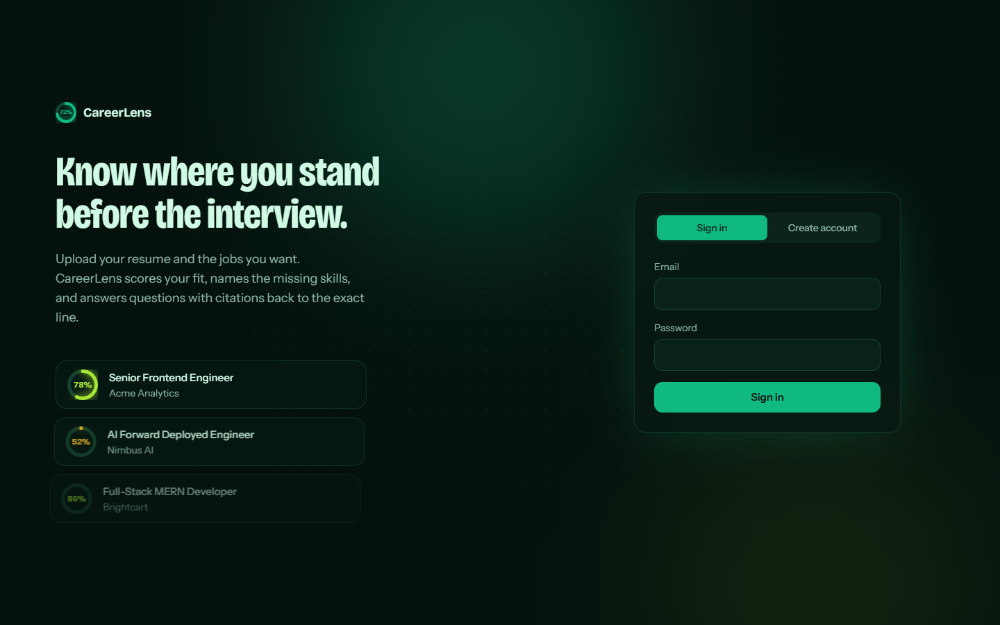
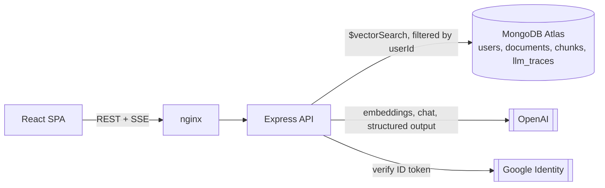

# CareerLens: Career Intelligence Assistant

Upload your resume and the job descriptions you are considering. CareerLens scores your fit for each job,
names the skills you're missing, and answers questions such as *"What am I missing for Job #2?"* or
*"Prepare me for the Nimbus interview"*. Every claim in an answer cites the document and section it came from.

Built for the Newpage Solutions AI FDE assignment (Option 4: Career Intelligence Assistant).

**Live demo:** https://p01--frontend--g6dls6wx7pbl.code.run (Northflank; the free tier may take a few seconds to wake up).
Create an account, then click **Try with sample data**.


| Sign in (email or Google) | Fit drawer | Admin and usage |
|---|---|---|
|  |  |  |

| Resume evaluation across jobs | Job scorecard |
|---|---|
|  |  |

**Stack:** MongoDB Atlas (documents and vector search), Express + TypeScript, React 19 + Vite + Tailwind v4, OpenAI.
**Tests:** 125 backend + 37 frontend. **Eval:** 12-question golden set run against the real model.

---

## 1. Quick start

### Prerequisites
Node 20+, an OpenAI API key, and a MongoDB Atlas cluster (the free M0 tier works). Docker is optional.

### Run locally
```bash
# backend
cd backend
cp .env.example .env        # fill in MONGODB_URI, OPENAI_API_KEY, JWT_SECRET
npm install
npm run dev                 # http://localhost:4000 — creates DB "career_intelligence" + vector index on first start

# frontend (second terminal)
cd frontend
cp .env.example .env        # optional: VITE_GOOGLE_CLIENT_ID
npm install
npm run dev                 # http://localhost:5190
```
Open http://localhost:5190, create an account, and click **Try with sample data** (one resume and three job descriptions).

### Run with Docker
```bash
docker compose up --build   # http://localhost:8080 (nginx serves the SPA and proxies /api)
```
No Atlas account? Set `MONGODB_URI=mongodb://mongo:27017/?directConnection=true` in `backend/.env` and
run `docker compose --profile local-db up --build`. This uses MongoDB's `atlas-local` image, which includes Vector Search.

### Deploy
The live demo runs as **two containers on Northflank**: the frontend (nginx serving the SPA and proxying `/api` over
Northflank's private network) and the API (private port, only reachable through the frontend). MongoDB Atlas holds the data.
Same images as `docker compose`, configured with environment variables (`API_UPSTREAM`, `PROXY_SECRET`, ...).

Also prepared and tested, but not used for the live demo: **Cloudflare Pages** for the frontend (a Pages Function proxies
`/api`, verified locally with `wrangler pages dev`) and **Cloudflare R2** for keeping original uploads (enabled by the
`R2_*` variables). Step-by-step guide for all options: [docs/deploy-cloudflare.md](docs/deploy-cloudflare.md).

### Google sign-in (optional)
In Google Cloud Console, open *APIs & Services → Credentials → OAuth client ID (Web)*. Add `http://localhost:5190` and
`http://localhost:8080` as authorised JavaScript origins. Put the client ID in `backend/.env` (`GOOGLE_CLIENT_ID`) and
`frontend/.env` (`VITE_GOOGLE_CLIENT_ID`). Without it, the Google button is hidden and email/password still works.

### Admin access
Sign in with Google using the address in `ADMIN_EMAIL`, or run `npm run make-admin -- you@example.com` in `backend/`.

### Tests and evaluation
```bash
cd backend && npm test      # unit + API tests (in-memory MongoDB, OpenAI faked)
cd frontend && npm test     # component tests
cd backend && npm run eval  # golden-set evaluation against the real model + Atlas (costs about $0.01)
```

---

## 2. Architecture



- **Ingest:** extract text (pdf-parse / mammoth) → split by section → embed → store chunks with `userId`, `docId`, label and section.
  The original file goes to Cloudflare R2 (`users/{userId}/{docId}.pdf`, private, downloadable only by its owner) when `R2_*` is configured.
  Adding a job, or replacing the resume, triggers a background **fit analysis** (one structured-output call per job)
  that returns a fit score plus a 5-criterion **scorecard** (ATS compatibility, JD keyword matching, technical skills,
  experience relevance, leadership & architecture). The resume panel compares all jobs side by side and adds a
  **rule-based ATS checklist** (contact details, section headings, measurable results, length, profile links).
  It's rule-based on purpose: those checks are mechanical, so code is instant, free, deterministic and explainable.
- **Chat:** guard → route ("Job #2", title or company) → retrieve → prompt → stream over SSE → citation filter → trace.
- **Auth:** email/password (bcrypt) or Google ID token → our own JWT in an httpOnly cookie; roles `user` / `admin`.

Full diagrams (components, chat sequence, data model) are in [docs/architecture.md](docs/architecture.md).

```
backend/src
  auth/       JWT cookie, Google verification, requireAuth / requireRole
  ingest/     extraction + section-aware chunker
  rag/        router (job refs), retriever (Atlas), context, guard, prompt, citations
  analysis/   per-job fit analysis (JSON schema output)
  llm/        OpenAI wrapper + token/cost tracing
  routes/     documents, chat (SSE), admin/metrics, health
frontend/src
  pages/      Login, Workspace, Admin
  components/ FitRing, ChatPanel, Message, FitDrawer, Sidebar, UploadZone, ...
```

---

## 3. RAG / LLM approach and decisions


| Concern | Options considered | Choice | Why |
|---|---|---|---|
| LLM | gpt-4o-mini, gpt-4.1-mini, Claude | **gpt-4o-mini** (configurable via `OPENAI_CHAT_MODEL`) | Cheap and fast enough for streaming. In the eval, gpt-4.1-mini did not fix citation misses; prompt changes did. |
| Embeddings | text-embedding-3-small / -large | **text-embedding-3-small** (1536-d) | Resumes and job descriptions are short and plain. The large model's extra accuracy isn't worth 6.5× the cost here. |
| Vector DB | Chroma, Pinecone, pgvector, **Atlas Vector Search** | **Atlas Vector Search** | Already on MongoDB (MERN), so one store for users, documents, vectors and traces. Pre-filters by `userId` and `docId`. The same code runs on `atlas-local` in Docker. |
| Orchestration | LangChain, LlamaIndex, hand-written | **Hand-written (~300 lines)** | Every step is visible and testable. A framework would hide exactly the decisions this assignment evaluates. |

**Chunking.** Resumes and job descriptions are short and highly structured, so text is split on their own headings
(Skills, Experience, Requirements, Nice to have…; [chunker.ts](backend/src/ingest/chunker.ts)). Long sections
are windowed at about 800 tokens with about 100 tokens of overlap. Each chunk keeps its document label and section, which
both drives the citations (`[Job #2 › Requirements]`) and lets retrieval filter by document. The embedded text is
prefixed with "Job – title – section" so each vector carries that context.

**Retrieval.** ([context.ts](backend/src/rag/context.ts))
1. **Small corpus → no search.** One resume plus a few job descriptions is usually under ~6k tokens, so everything is sent.
   Retrieval can only *lose* information; it earns its keep when the corpus outgrows the context budget.
2. **Targeted questions.** [router.ts](backend/src/rag/router.ts) resolves "Job #2", "#2", or a distinctive
   title or company word ("Nimbus") to job IDs, then searches *only* those jobs plus the resume (k=4 each). Without this,
   similar requirement sections from different jobs get mixed together.
3. **Untargeted questions.** Global top-8, then at least 2 resume chunks are guaranteed, because every question here is "me vs. the job".
4. References to jobs that don't exist ("Job #7") are reported to the model, which tells the user.

**Prompt and context management.** ([prompt.ts](backend/src/rag/prompt.ts))
- System prompt: role, grounding rules, citation format with a worked example, "check every resume section before calling something a gap", and documents declared as untrusted data.
- Document text goes into escaped `<document label section>` blocks, and titles are flattened and escaped.
- Retrieved context is attached only to the current turn. History is the last 6 turns, capped at 4k characters per turn and 12k in total.
- A citation reminder is the **last line** of the user message, because recency measurably helped.

**Guardrails.**
| Layer | What |
|---|---|
| Input | length limits; scanned/empty documents rejected; off-topic classifier (keyword fast path, otherwise a 1-word LLM call; *fails open*, because a wrong refusal is worse than a grounded answer) |
| Cost / abuse | per-user rate limits: 20 chats/min and 30 uploads/re-scores per 10 min; at most 10 jobs per user; sample data only into an empty workspace; login rate-limited |
| Prompt injection | documents are tagged and escaped, untrusted-data instruction, and model output is rendered without images or non-http links |
| Output | citations pointing at documents that were not in the context are removed ([citations.ts](backend/src/rag/citations.ts)) |
| Structured | the fit analysis uses JSON-schema structured output and is validated again with zod |
| Tenancy | every query and every `$vectorSearch` is filtered by `userId`; other users' IDs return 404 |

**Quality: the eval loop.** `npm run eval` runs 12 golden questions over the sample data against the real model
and Atlas, and measures **grounded answers** (≥1 valid citation; the gate is ≥90%), **label recall** and **keyword recall**.
What it caught:

| Change | Grounded | Label recall | Keyword recall |
|---|---|---|---|
| First prompt | — | 40%* | 97% |
| + worked example, end-of-message reminder, evidence rule | 100% | 100%* | 100% |
| + table questions added to the golden set (exposed a regression), + "tables need a Source column" | 100% | 88–96% | 89% |

\* the first metric counted a question as passed only if *all* expected documents were cited. It was replaced because
"what am I missing" answers legitimately cite only the job (you can't cite an absence). Results vary about ±8 points
between runs, so compare a few runs before trusting a change.

**Observability.** Structured pino logs with a request ID on every request (`x-request-id`). Every LLM call is
written to `llm_traces` (operation, model, tokens, latency, cost). `/api/metrics` shows a user their own usage, and the
admin dashboard shows totals, p50/p95 latency, spend per operation and per user. Each chat logs its retrieval
decisions (full-text vs. search, targeted jobs, missing refs, number of sources).

---

## 4. Productionising on a hyperscaler


| Area | Now | Production |
|---|---|---|
| Compute | 2 containers | AWS ECS Fargate / GCP Cloud Run / Azure Container Apps; frontend as static files on S3 + CloudFront (or Cloudflare Pages) |
| Database | Atlas M0 | Atlas M10+ in the same region and cloud, private endpoint / VPC peering, backups, dedicated Search Nodes when vector load grows |
| Ingestion | in-request + fire-and-forget analysis | queue (SQS / Pub/Sub / Service Bus) + worker; retries; status per document; virus scan on uploads; original files in object storage |
| Secrets | `.env` | Secrets Manager / Secret Manager / Key Vault; key rotation; least-privilege DB user |
| Auth | JWT cookie, Google | refresh tokens with rotation, email verification and password reset, MFA, or a managed IdP (Cognito / Auth0 / Entra ID) |
| Abuse and cost | in-memory rate limit | Redis-backed limits per user and IP, monthly token budgets per user, WAF |
| Observability | pino + `llm_traces` | OpenTelemetry traces → CloudWatch / Cloud Logging / Datadog; LLM tracing in Langfuse or LangSmith; alerts on error rate, p95 and spend |
| Quality | local golden set | eval in CI on prompt or model changes, a larger golden set, LLM-as-judge for faithfulness, user feedback buttons feeding the set |
| Delivery | manual | GitHub Actions: lint, test, build, image scan, deploy to staging, smoke test + eval, promote |
| Privacy | — | resumes are PII: encryption at rest, retention policy, deletion on request, a data-processing agreement with the LLM provider |

---

## 5. Key technical decisions

**Option 4 (Career Intelligence).** I was job hunting while doing this assignment, so I could judge the answers
against my own resume. It also has a clear product shape: one resume, many jobs, and questions that compare them.

**MERN with MongoDB Atlas Vector Search.** MERN is the stack I work in daily, so I could defend every line. Atlas
Vector Search let me keep users, documents, vectors and LLM traces in one database instead of running and syncing a
separate vector store. The same code runs locally (`atlas-local` image) and in the cloud.

**A small hand-written RAG pipeline instead of LangChain/LlamaIndex.** The assignment is about chunking, retrieval
and prompt decisions. A framework would have hidden exactly those. The whole pipeline is about 300 lines, and every step
has unit tests.

**Send the full documents when they fit.** A resume plus a few job descriptions is usually well under ~6k tokens.
At that size vector search can only *lose* information, so I skip it and only fall back to search when the
documents grow. This was a deliberate trade-off against "always use the vector DB".

**Route questions to the right job.** "What am I missing for Job #2?" must not pull Job #1's requirements, which look
semantically similar. A small router resolves "Job #2", "#2", or a distinctive title/company word, and filters
retrieval to that job plus the resume.

**Split chunks by section.** Resumes and job descriptions have strong headings (Skills, Experience, Requirements). Chunking
on them makes citations meaningful (`[Job #2 › Requirements]`) and keeps "Benefits" out of a skills answer.

**Rules where rules are enough.** The ATS checklist (contact details, headings, measurable results, length, links) is
plain code, not an LLM call. It is instant, free and gives the same answer every time. The LLM is only used for
judgement (fit scores, gaps, answers).

**Security choices.** JWT in an httpOnly cookie (not localStorage); the role is read from the database on every
request so a demotion applies immediately; `userId` on every query and every vector search; documents treated as
untrusted input in prompts. The admin role is only granted through a verified (Google) email, never through a password
sign-up.

**Testability through dependency injection.** `createApp(deps)` receives the LLM client, retriever, file store and
Google verifier, so tests swap in fakes and run without network access or API cost. Only MongoDB is real (in-memory).

**Deployment.** Two containers on Northflank. The frontend's nginx proxies `/api` over the private network, so the
API has no public port and the browser sees one origin (simple cookies, no CORS issues, streaming works).

---

## 6. Engineering standards

**Followed**
- TypeScript `strict` on both sides; environment validated with zod at startup (fails fast).
- Tests written first: 125 backend tests (chunker, router, prompt, guardrails, auth/RBAC, tenant isolation, SSE chat, admin,
  ATS checks, cost limits, race conditions, scanned PDFs) and 37 frontend tests (login, sign-up, chat streaming, citations,
  fit ring, scorecards, admin, uploads, markdown sanitising, session restore, Pages proxy).
- A separate reviewer pass over the whole branch before submission; its critical and important findings were fixed, each with a
  regression test that failed first.
- External services behind interfaces (`LlmClient`, `Retriever`, `GoogleVerifier`) and injected into `createApp`.
- Small, single-purpose modules; comments explain *why*, not *what*.
- Central error handler; errors are user-readable and never leak stack traces.
- Conventional commits, one commit per feature or fix.
- Multi-stage Docker images running as a non-root user, with a health check.

**Skipped (time-boxed)**
- No ESLint/Prettier config committed (relied on `tsc --noEmit` / `tsc -b` and editor formatting).
- No end-to-end browser tests in CI (verified manually with Playwright; screenshots are from that run).
- No CI pipeline yet.
- The eval golden set is small (12 questions) and written by me, so it can overfit.

---

## 7. How I used AI tools

I used **Claude Code** (in VS Code) as a pair programmer, with a fixed process rather than "just write the app":

1. **Brainstorm, then a written design spec** ([docs/superpowers/specs](docs/superpowers/specs)). I made the product calls:
   Option 4, the MERN stack, the "Midnight Emerald" theme (picked from three live mockups), Google sign-in with
   user/admin roles, Atlas as the database, Northflank for hosting, and later the resume-evaluation scorecard.
   The assistant proposed options and trade-offs.
2. **A task-by-task plan** ([docs/superpowers/plans](docs/superpowers/plans)) with file names, interfaces and test cases.
   Both documents are committed, so the work is repeatable and a reviewer can see *why* the code looks the way it does.
3. **Tests first.** Each task started with a failing test, then the code to make it pass. That is how I kept the code
   to my standards: the tests describe the behaviour I want, and nothing merges without them.
4. **Independent checks.** An automated security review ran on every commit (10 findings over the project, all fixed
   with regression tests), a separate reviewer read the whole branch before submission, and the eval ran against
   the real model.

**What the AI got wrong, and how I caught it**
- The first prompt cited sources in only 40% of answers against the real model. The tests passed because they used a fake
  model. The eval caught it, and prompt changes fixed it.
- The streaming chat hung behind the dev proxy. I only saw that in a real browser, not in tests.
- A scanned PDF was being stored with "-- 1 of 2 --" as its title, because the PDF library inserts page markers.
  The final review caught it.
- During testing an old server process kept serving stale code. Lesson: check what is actually running before trusting a result.

**My do's and don'ts with AI coding assistants**
- **Do** give it a spec and a plan first. Vague requests produce code you can't defend.
- **Do** make it write the failing test before the code, and read the tests yourself: they are the contract.
- **Do** check against reality (real model, real browser, real container). Fakes and mocks hide integration bugs.
- **Do** make the decisions yourself and let it lay out options and trade-offs.
- **Don't** accept "it works" without running it.
- **Don't** let it add a library or framework you can't explain in an interview.
- **Don't** paste secrets into the chat. I did this once with a database URL; secrets belong in `.env` only, and
  anything exposed gets rotated.

---

## 8. What I'd do differently with more time

- **Hybrid retrieval.** Combine keyword search (Atlas Search / BM25) with vectors, because exact skill names like
  "WCAG" or "Kubernetes" matter more here than general similarity. Then evaluate retrieval separately from generation.
- **A bigger, harder eval set.** The current 12 questions were written by me and can overfit. I would add real
  resumes and job descriptions, an LLM-as-judge for faithfulness, and run the eval in CI on every prompt or model change.
- **Evidence for every score.** Show the resume line behind each matched skill and each scorecard number, so the
  candidate can trust (or argue with) the score.
- **Skill normalisation.** Map "React.js" and "ReactJS" to "React" with a small taxonomy, so scores are stable between runs.
- **Production basics I skipped:** a CI pipeline, Redis-backed rate limits, a background queue for analysis, OCR for
  scanned PDFs, and a confirm/undo step on delete.
- **Product ideas:** saved conversation history, an exportable interview-prep pack, and a voice mock-interview mode.

---

## 9. Known limitations

- gpt-4o-mini sometimes misses indirect evidence (e.g. it still lists "customer-facing experience" as a gap although
  the sample resume mentions working with client stakeholders).
- Scanned (image-only) PDFs have no text layer and are rejected (no OCR).
- Fit analysis runs fire-and-forget in the API process; if the process restarts mid-analysis, use "Re-score".
- The in-memory rate limiters are per instance (need Redis when scaled out).
- Deleting a document is immediate (no confirm or undo).
- Uploads are capped at 5 MB and 200k extracted characters; DOCX/PDF parsing itself still happens in-process.
- Chat history lives in the browser only.
