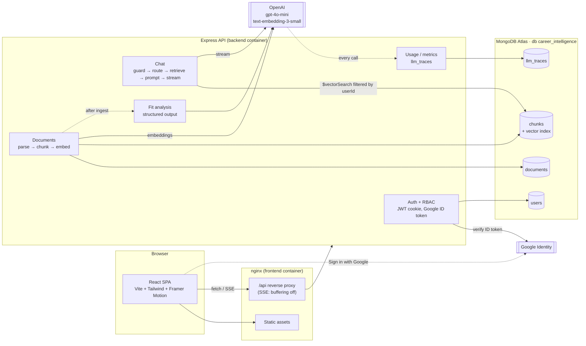
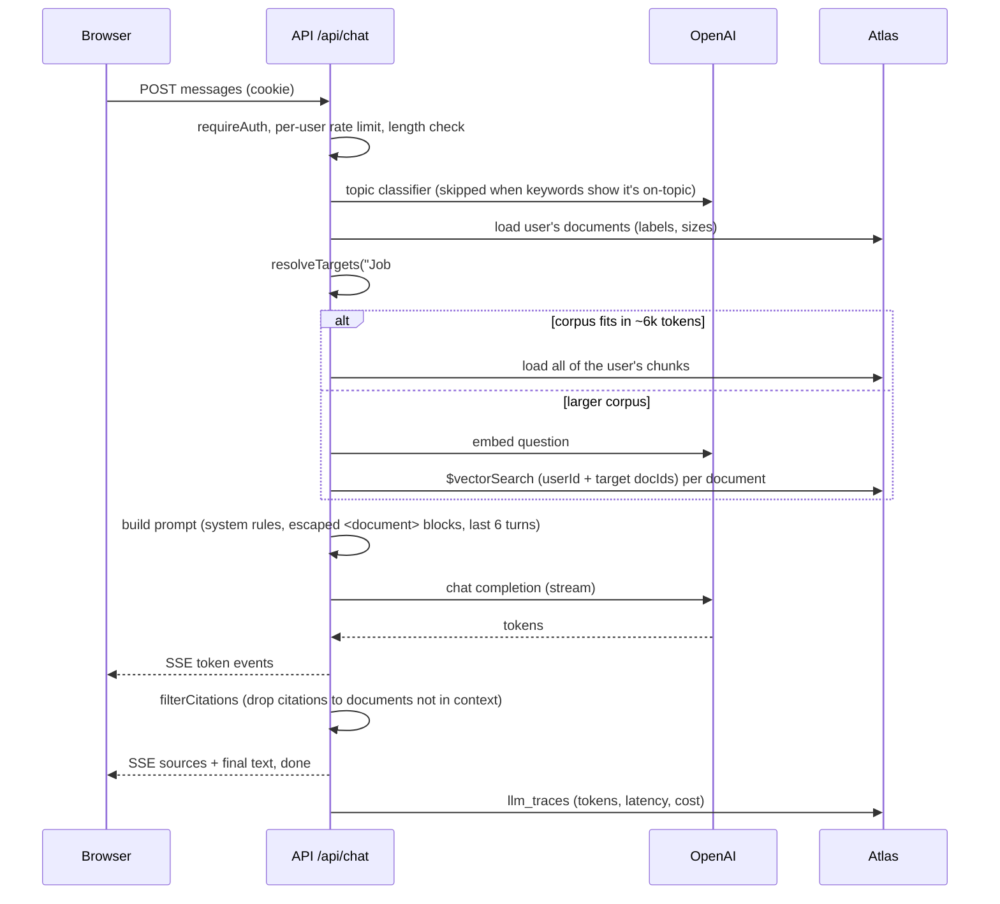

# Architecture

## Components

## Chat request, step by step

## Data model

| Collection | Key fields | Notes |
|---|---|---|
| `users` | email (unique), passwordHash?, googleId?, role, sessionVersion | `sessionVersion` is bumped when credentials change; older JWTs stop working |
| `documents` | userId, kind (resume/job), label ("Job #2"), jobNumber, title, company, rawText, analysis | one active resume per user |
| `chunks` | userId, docId, kind, label, section, text, order, embedding[1536] | Atlas Vector Search index `chunk_vector_idx`, filters userId/docId/kind |
| `llm_traces` | userId, requestId, op, model, tokens, latencyMs, costUsd | feeds `/api/metrics` and the admin dashboard |
